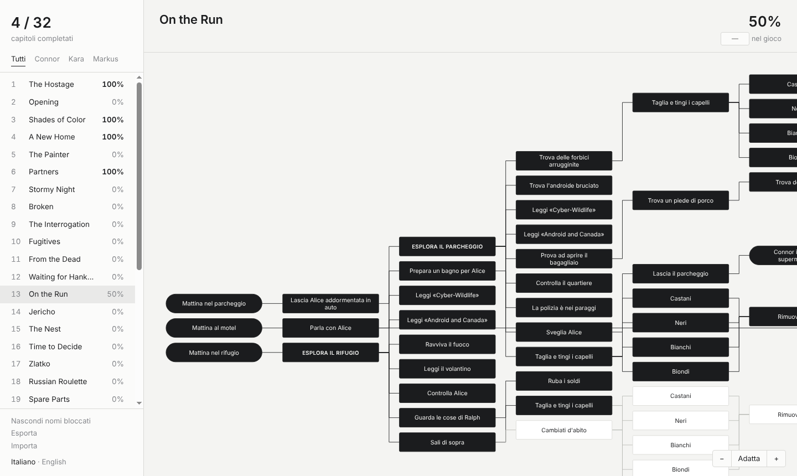

# Flowchart Tracker per Detroit: Become Human

App desktop offline per segnare i nodi sbloccati nei diagrammi di *Detroit: Become Human*, capitolo per
capitolo. Serve a chi punta al 100% dei diagrammi e al trofeo di platino: mostra cosa manca in ogni
capitolo e quali scelte servono per arrivarci.

*[English below](#english)*



## Funzioni

- **Tutti i 32 capitoli**, trascritti a mano dai diagrammi del gioco, con il nome italiano e quello
  originale inglese di ogni nodo.
- **Clic su un nodo** per segnarlo come sbloccato (o Invio/Spazio da tastiera). Passandoci sopra con il
  mouse compaiono i due nomi e la nota del nodo.
- **Note sui requisiti**: quali scelte dei capitoli precedenti servono per sbloccare un ramo.
- **Selettore del personaggio** nei capitoli con più diagrammi (Crossroads, Night of the Soul,
  Battle for Detroit), con i percorsi separati di ciascuno.
- **Percentuali**: quella calcolata dal tracker per ogni capitolo e quella che mostra il gioco, da
  scrivere a mano accanto.
- **Nascondi nomi bloccati**, per evitare spoiler sui nodi non ancora visti.
- **Backup** dei progressi in un file JSON, da esportare e reimportare.
- **Offline**: l'app non si collega a internet. Tema chiaro e scuro automatico, interfaccia in italiano
  e inglese.

## Download

1. Vai alla pagina **Releases** di questo repository e scarica `FlowchartTracker.exe`.
2. Avvialo: è portable, non serve installarlo.

Funziona su Windows. L'eseguibile non è firmato digitalmente, quindi al primo avvio Windows SmartScreen
può mostrare un avviso: scegli **Ulteriori informazioni → Esegui comunque**.

I progressi sono salvati sul computer, nella cartella `%APPDATA%\Flowchart Tracker`.

## Compilare da sorgente

Serve Node.js 22 o successivo.

```
npm install
npm start          # avvia l'app
npm run dist       # crea dist/FlowchartTracker.exe (su Windows)
```

A ogni push GitHub Actions compila l'eseguibile e lo allega alla build. Quando si pubblica un tag `v*`
(per esempio `v1.0.0`), lo stesso workflow crea la Release con `FlowchartTracker.exe`.

## Contribuire

Se un nodo è sbagliato, manca o è collegato male, apri una issue indicando il **capitolo**, il **nodo**
(meglio con il nome inglese) e cosa non va. Uno screenshot del diagramma nel gioco aiuta molto. Alcuni
collegamenti sono poco leggibili anche nel gioco: quei nodi hanno una nota che inizia con
«Collegamento da verificare».

Per correggere i dati direttamente: i diagrammi sono in `data/manual/`, un file JSON per capitolo.
Dopo la modifica cambia il campo `"rev"` del file (per esempio da `"manual-1"` a `"manual-2"`): così l'app
aggiorna il capitolo per chi la usa già, senza perdere i nodi sbloccati. I dettagli sono in
[CONTRIBUTING.md](CONTRIBUTING.md).

I nomi italiani dei nodi sono **traduzioni non ufficiali**, non le etichette della versione italiana
del gioco.

## Note legali

Progetto amatoriale e non ufficiale, non affiliato a Quantic Dream né a Sony Interactive Entertainment
e non approvato da loro. *Detroit: Become Human* e i nomi di capitoli, personaggi ed eventi sono marchi
dei rispettivi proprietari. Il repository non contiene immagini né altre risorse del gioco.

Il codice è distribuito con [licenza MIT](LICENSE).

---

## English

An unofficial, offline desktop app to track the flowchart nodes you have unlocked in
*Detroit: Become Human*, chapter by chapter, on the way to 100% and the platinum trophy.

- All 32 chapters, transcribed by hand from the in-game flowcharts, with the original English names
  and Italian translations. Switch language at the bottom of the sidebar.
- Click a node to mark it as unlocked; hover it to read its notes and requirements.
- Character selector for chapters with several flowcharts, per-chapter percentage and a field for the
  percentage shown by the game, spoiler protection, JSON backup, light and dark theme.

**Download:** get `FlowchartTracker.exe` from the **Releases** page. It is portable and Windows-only;
the executable is not code-signed, so SmartScreen may ask you to confirm (**More info → Run anyway**).

**Mistakes:** open an issue with the chapter, the node and what is wrong. See
[CONTRIBUTING.md](CONTRIBUTING.md).

Fan project, not affiliated with or endorsed by Quantic Dream or Sony Interactive Entertainment. All
trademarks belong to their owners; no game assets are included. Code released under the MIT License.
